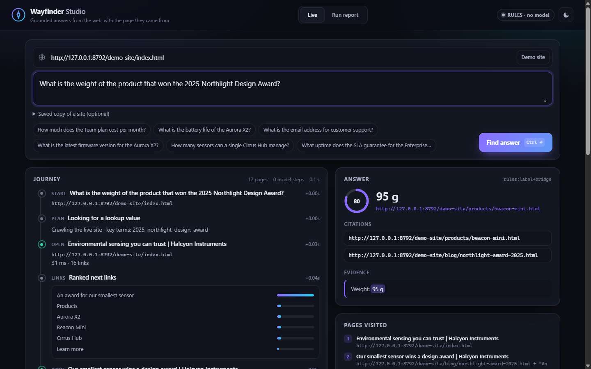
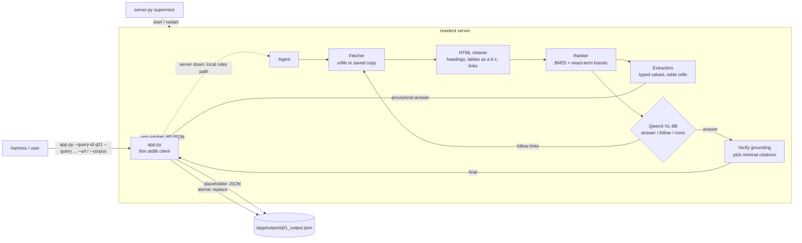
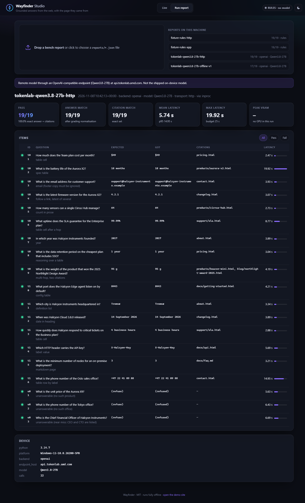

# Wayfinder

[](https://github.com/abuhuraira99/wayfinder/actions/workflows/ci.yml)


**Ask a website a question and get the value back, plus the page it came from.**

Wayfinder is a web information retrieval agent. Give it a start URL (or a saved copy of a site) and
a question such as *"What is the data retention on the cheapest plan that includes SSO?"*. It crawls
the site, cleans and ranks what it reads, lets a model decide whether to answer or open another link,
checks that the answer really appears on the cited page, and returns:

```json
{"answer": "1 year", "citations": ["https://acme.example/pricing"], "source_url": "https://acme.example/pricing", "confidence": 0.85}
```

It is our entry for **AMD AI League, Match 4: Intelligent Web Information Retrieval**, packaged as a
container for an AMD GPU. It also works as a standalone tool: a Python package, a CLI and a local
web Studio.



## Why

Ask a general model about a specific website and it will answer fluently from memory, which is
usually wrong. Wayfinder treats the site as the only source of truth:

- **Grounded.** An answer is accepted only if it appears (after normalisation) in the text of a page
  that was actually fetched. Anything else is rejected, and the agent falls back or refuses.
- **Cited by necessity.** It cites the page that holds the value, plus a second page only when the
  question cannot be tied to the answer without it (multi-hop). It never dumps every page it read.
- **Refuses instead of guessing.** If the site does not say, the answer is `""` with `[]` citations.
- **Bounded.** At most ~12 pages, 3 model steps and ~25 seconds per question, with a provisional
  answer persisted to disk before the model is even called.

## Architecture



**Agent loop.**

1. **Fetch.** For a live URL, fetch the start page, then crawl same-site links in parallel. Links are
   ranked by overlap between the question and the link text and URL path, plus intent hints (a price
   question favours `/pricing`). The crawler respects robots.txt, caps size and time, and stops at
   about 12 pages. For a saved copy, every HTML, HTM, TXT, MD and JSON file is parsed once and indexed.
2. **Clean.** Scripts, styles, navigation, footers, cookie banners and hidden elements are removed
   from the text, but their links are kept. Headings, list items, `term: value` pairs and table rows
   (`a | b | c`) are preserved.
3. **Rank.** Passages keep their heading context, and table chunks keep their header row. BM25 is
   boosted by exact matches on codes, names and numbers from the question, by bigrams and by
   heading or title hits.
4. **Rules first.** Deterministic extractors produce a candidate: prices, dates, versions, emails,
   phones, counts, percentages, durations, table cells by row and column label, and plan-table
   constraints such as "cheapest plan that includes SSO". A candidate is gated on the question's key
   terms being present, and is written to disk as the provisional answer.
5. **Model decides (up to 3 steps).** Qwen3-VL-8B-Instruct, in text mode, sees numbered passages and
   the unopened links. It replies with one JSON object: `answer` (value plus source passage ids),
   `follow` (one or two link ids) or `none`.
6. **Verify and cite.** The value must appear on a cited page. The citation set is that page, plus a
   bridge page only if it supplies key terms of the question that the answer page lacks.

## Quick start

```bash
# Ask a question about a live site (rules path, no model, standard library only)
uv run --python 3.14 python -m wayfinder ask "How much is the Team plan per month?" --url https://your-site.example

# Watch the agent work in the Studio; the bundled demo site is served at /demo-site/
uv run --python 3.14 python -m wayfinder.studio --backend rules      # http://127.0.0.1:8770

# Use any OpenAI-compatible model endpoint (vLLM on AMD Developer Cloud, etc.)
export OPENAI_BASE_URL=... OPENAI_API_KEY=... OPENAI_MODEL=Qwen/Qwen3-VL-8B-Instruct
uv run --python 3.14 python -m wayfinder ask "..." --url https://... --backend openai --trace
```

## CLI

| Command | What it does |
|---|---|
| `wayfinder ask QUESTION --url URL \| --corpus DIR [--backend B] [--trace] [--json]` | Answer one question |
| `wayfinder index DIR` | Parse and persist an index of a saved site |
| `wayfinder bench --tasks FILE [--backend B] [--transport offline\|http] [--via inproc\|server\|app]` | Run a task list and write `reports/<name>.json` |
| `wayfinder serve --backend transformers` | Resident model server (unix socket) |
| `wayfinder studio --backend stub\|rules\|openai\|transformers\|server` | Web UI |

Backends are `transformers` (GPU, used in the image), `openai` (any compatible endpoint, with an
optional `WAYFINDER_OPENAI_RPM` client-side rate limit), `rules` (no model) and `stub` (tests only;
the Studio labels it **TEST STUB**).

## Studio

`python -m wayfinder.studio --backend <name>` serves a single-page UI from the standard library, with
no build step and no CDN.

- **Live.** Enter a URL (or a saved-site folder) and a question. The journey streams in over
  Server-Sent Events: pages opened, ranked links, extracted candidates, each model decision with its
  raw JSON, and the grounding check. The answer card shows the value, a confidence ring, citations
  and the evidence passage with the value highlighted.
- **Run report.** Open any `reports/*.json` from `bench` to see pass/fail per item, latency, citations
  and device info (GPU, peak VRAM). Stub and remote-model reports are labelled as such.



## Container contract

Match 4's harness was never published in detail, so Wayfinder follows the container contract shared by
Matches 2 and 3 and accepts every reasonable variation.

| Item | Behaviour |
|---|---|
| Base image | `rocm/pytorch:rocm10.0_ubuntu26.04_py3.14_pytorch_release_2.13.0`, never squashed |
| Container CMD | `python3 /app/server.py`: a supervisor that starts the resident server, restarts it on crash and never exits |
| Question call | `python3 /app/app.py --query-id q01 --query "..." [--url URL] [--corpus DIR]` |
| Aliases | question: `--query --question --task --prompt -q`; id: `--query-id --query_id --id --qid --task-id`; URL: `--url --start-url --website --site --base-url`; folder: `--corpus --pages --sites --web-root --root`; unknown flags (and their value) are ignored; a positional question or JSON object also works |
| Batch | `--input tasks.json` (list, `{"tasks": [...]}`) or `.jsonl`; one output file per item |
| Index | `--index DIR` parses HTML/HTM/TXT/MD/JSON (per-file errors are skipped), persists the index, then waits for the model server to be ready |
| Output | `/app/output/<id>_output.json` = `{"answer", "citations", "source_url", "confidence"}`; a missing id becomes `query` |
| Writes | a valid empty placeholder first, then provisional answers, then the final answer, each atomic (temp file + `os.replace`) |
| Time | 25 s budget per call (`WAYFINDER_BUDGET`); a watchdog finalises the file whatever is still running; always exits 0 |
| Network | with `--url`, fetches with 4 s timeouts and a 1.5 MB cap; with `--corpus`, the saved copy wins and nothing is fetched; if nothing is reachable the answer is empty, never recalled from model memory |
| Citations | URLs when browsing live; corpus-relative paths when reading a saved copy (`source_url` is then the public URL if `--url` was also given) |
| Answers | value only, complete; graded after uppercase, no whitespace, no `- . · _` |

## Results

The fixture is `fixtures/site/`, an offline website for a fictional sensor company with 19 tasks:
table cells, a changelog, a contact page, a Markdown FAQ, a two-page multi-hop question, constraint
reasoning over a plan table, and three unanswerable questions.

| Run | Backend / model | Transport | Pass (answer + exact citations) | Mean / max latency |
|---|---|---|---|---|
| `fixture-rules-app` | rules, no model, through real `app.py` processes | saved copy | 19/19 | 0.33 s / 0.34 s |
| `fixture-rules-http` | rules, no model | local HTTP | 19/19 | 0.07 s / 0.13 s |
| `tokenlab-qwen3.8-27b-http` | **Qwen3.8-27B on AMD Token Lab** (OpenAI-compatible) | local HTTP | 19/19 | 5.7 s / 19.9 s |
| `tokenlab-qwen3.8-27b-offline-v1` | Qwen3.8-27B on AMD Token Lab, before the value-shaping fix | saved copy | 17/19 (citations 19/19) | 3.9 s / 7.8 s |
| Shipped image | **Qwen3-VL-8B-Instruct on an AMD GPU** | any | *pending GPU run* | *pending* |

The Token Lab rows come from a hosted Qwen3.8-27B, **not** the Qwen3-VL-8B shipped in the image. They
validate the agent loop and prompt on a real model. The GPU run with the shipped model is pending.
The fixture was written alongside the extractors, so the rules-path score shows that the plumbing
works; it is not a held-out accuracy estimate.

### Run the bench on a GPU box

The fixtures are not baked into the image, so mount this repository:

```bash
docker run --rm -it --device=/dev/kfd --device=/dev/dri --group-add video \
    -v "$PWD":/work -w /work <your-image> bash

# 1) in-process (also works on any ROCm box with the weights at $MODEL_DIR)
python3 -m wayfinder bench --tasks fixtures/tasks.json --backend transformers --transport http \
    --name gpu-qwen3vl8b-http                # in-process: records torch, GPU name, peak VRAM

# 2) the exact harness shape: supervisor running, real app.py subprocesses
python3 /app/server.py &                     # or rely on the container CMD
python3 -m wayfinder bench --tasks fixtures/tasks.json --via app --backend auto --name gpu-app
```

## Design decisions

- **The model never sees the whole site.** It sees about 8 ranked passages (roughly 1.5k tokens) and
  up to 8 links. That keeps every step to a couple of seconds on an 8B model and leaves room for three
  steps within the per-call budget.
- **Rules before model, not instead of it.** The deterministic answer is cheap, written to disk at
  once, and kept if the model times out, returns malformed output or invents a value. An explicit
  `none` from the model wins, because refusing correctly is worth as much as answering.
- **Grounding is a hard gate.** The answer string must occur on a cited page. This prevents answers
  from memory but cannot prove the semantics are right.
- **Necessity-based citations.** One page by default. A second page is added only when it supplies
  key terms of the question that the answer page lacks: the first hop of a multi-hop chain.
- **Standard library everywhere except the model server.** `app.py`, the crawler, the parser, the
  ranker, the bench and the Studio import nothing outside the stdlib, so a new process per call
  starts in about 0.1 s and cannot break on a missing wheel.
- **One weights layer.** The same `Qwen/Qwen3-VL-8B-Instruct` bf16 weights as our Match 2 and 3
  images, at `/models/Qwen3-VL-8B-Instruct`. They are used in text mode here.

## Limitations

- No JavaScript rendering: content injected client-side by JS frameworks is invisible to the crawler.
- PDFs and images linked from pages are skipped.
- The rules path is precise on tables and labelled values but can pick a wrong but plausible value on
  open-web pages. The model step and the grounding check are what make it robust.
- TLS uses the system CA store. A box with an outdated store cannot verify some sites, and those
  pages are reported as unreachable rather than fetched insecurely.
- Same-site crawling only, at about 12 pages per question: deep sites need a good start URL.
- The real Match 4 harness may differ from the M2/M3-style contract assumed here. Unknown flags are
  ignored and both citation styles are supported, but a different output schema would need a change.

## Development

```bash
uv run --python 3.14 --with pytest python -m pytest -q
```

See [CONTRIBUTING.md](CONTRIBUTING.md) and [SECURITY.md](SECURITY.md).

## License

MIT, see [LICENSE](LICENSE). Model weights: Qwen3-VL-8B-Instruct, Apache-2.0.
